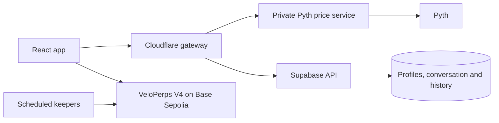

<h1 align="center">Velo</h1>

<p align="center"><b>Trade the market. Share the thinking behind it.</b></p>
<p align="center">Perpetual trading, market discovery and a trader community, together.</p>
<p align="center">
  <a href="https://app.velotrading.live">Open Velo</a> ·
  <a href="https://velotrading.live">Website</a> ·
  <a href="https://velotrading.live/docs">Product guide</a> ·
  <a href="VISION.md">Vision</a>
</p>
<p align="center">Public testnet on Base Sepolia · Test collateral: mUSDC</p>

## Why Velo

A trade starts with an idea. Today, that idea often lives in a social feed, the research in another tab and the position on a separate exchange. Following the whole story takes work.

Velo brings those steps together. Discover an asset, read what traders are saying, open a position and share it with the conversation attached. Followers can inspect the trade, follow its progress and see how it settles.

The ambition is a home for traders: a place to research markets, execute, build a reputation and learn from one another. Crypto perpetuals are the starting point.

## Inside the product

| Area | Experience |
| --- | --- |
| **Trade** | Nine Pyth-priced perpetual markets, isolated margin, market/limit/stop entries, take-profit and stop-loss, and leverage up to 25× |
| **Dashboard** | Account equity, buying power, open exposure, realized performance, settlement calendar and account activity |
| **Markets** | A top-50 crypto directory with watchlists, asset information, charts, news and a discussion for each coin |
| **Social** | Posts, threaded replies, reactions, reposts, follows, @mentions and $asset tags |
| **Trade sharing** | Compact live positions and high-resolution PnL images, with light/dark cards, amount controls and transaction details |
| **Profiles & rankings** | Trader profiles, public posts, performance summaries and period-filtered leaderboards |
| **Wallet** | Signature-based sign-in, a dedicated trading wallet, test funds, deposits, withdrawals, sends and testnet bridge routes |

[Explore the full feature guide →](FEATURES.md)

### From idea to outcome

1. **Discover.** Browse a market, its news and the conversation around it. Post directly from a coin page; Velo adds its $tag and publishes it to the feed.
2. **Trade.** Choose margin and leverage, set optional TP/SL and submit. A dedicated trading wallet signs orders locally, keeping the flow quick and focused.
3. **Share.** Attach an open position to a post, or create a 2400 × 1600 PnL image. Keep a Velo post live as the trade develops, or capture a fixed moment.
4. **Review.** Open position details for prices, timestamps and transaction links. Use Performance to explore realized PnL, market results and individual settlements.

Live shares update their values in place and show the settled result when the position closes. Exported PNGs preserve the moment you captured. The image viewer brings the original post, reactions and comments alongside the image.

### Markets

**BTC · ETH · SOL · DOGE · PYTH · BNB · XRP · HYPE · STETH**

Market-specific leverage reaches 25× for BTC/ETH, 20× for SOL/BNB, 15× for XRP and 10× for the remaining pairs. The wider market directory covers the top 50 crypto assets for research and discussion.

## How trading works

Velo's V4 engine settles positions on Base Sepolia using signed Pyth prices and a contract-held liquidity pool. Each market has its own leverage and risk settings. Trader collateral, pending-order margin, pool capital and accrued fees have separate accounting.

- **Market entries** validate the price update, execution deadline, price bound, margin and available liquidity in one transaction. TP/SL can attach in that same transaction.
- **Limit and stop entries** reserve collateral on-chain. Scheduled keepers submit eligible orders, and the engine checks their conditions at execution.
- **Position management** includes protection edits, full closes and automatic TP/SL and liquidation checks.
- **Confirmation** connects the position, trade history and account activity to the successful transaction receipt.

The dashboard charts account equity, including available funds and open exposure. Performance charts realized trading results separately, so funding your account and earning a trading profit remain distinct.

### Fees and liquidity

Opening fees are **0.10% of requested notional**. Closing fees are **0.10% of fixed position notional**. Borrowing defaults to **0.01% per hour** on notional; keeper-triggered settlement can include a keeper fee. The [execution guide](docs/EXECUTION.md) includes a worked example.

Protocol-owned liquidity backs positions. V4 reserves each position's maximum gross-profit payout at entry; gross profit is capped at one position notional and losses at collateral. Contract permissions preserve trader escrow and reserved liquidity during operator withdrawals.

## Architecture



| Layer | Technology and role |
| --- | --- |
| Interface | React 19, TypeScript, Vite, TanStack Query and Zustand |
| Wallets & chain access | Reown AppKit, wagmi and viem |
| Hosting & API gateway | Cloudflare Pages and Workers |
| Prices | Pyth for execution; CoinMarketCap for the wider asset directory |
| Account & social services | Supabase APIs, Postgres, Realtime and Storage |
| Execution | Solidity V4 engine, Foundry tests and scheduled keepers with transaction recovery |
| Design | Switzer interface type, Fraunces wordmark/editorial type, responsive glass surfaces and accessible motion |

**VeloPerps V4:** [`0xE9AEcFbc5814ce3b2dB0107594d80F054e6dB52f`](https://sepolia.basescan.org/address/0xE9AEcFbc5814ce3b2dB0107594d80F054e6dB52f#code). Source is published on BaseScan and Sourcify. The [deployment manifest](contracts/deployments/base_sepolia.json) lists the supporting contracts.

## Build with Velo

Use Node 22.12 or newer.

```sh
npm ci
npm run dev
npm run typecheck
npm test
npm run build
```

The [development and operations guide](docs/OPERATIONS.md) covers configuration, local API services and releases. Keep provider credentials and signing keys in server-side secrets; `VITE_*` settings are public build inputs.

```text
src/          App views, components, services and design system
api/          Account, social and transaction API handlers
cloudflare/   Gateway, private price service and keeper scheduler
supabase/     Functions, database migrations, Realtime and Storage
contracts/    V4 engine, supporting contracts and Foundry tests
shared/       Market registry, configuration and shared routes
scripts/      Build and release tooling
tests/        Application and service regression checks
docs/         Product and engineering references
```

## Product direction

Velo's next chapter develops verifiable trader histories, copy trading with allocation and risk controls, strategy automation and richer research. Engine development covers funding, capital efficiency and expanded position management. Longer term, the trader hub extends to stocks and commodities.

Read the [vision](VISION.md) for the product and business direction, and [engine roadmap](FUTURES.md) for the technical workstreams.

## Documentation & contact

[Feature guide](FEATURES.md) · [Sharing](docs/SHARING.md) · [Architecture](docs/ARCHITECTURE.md) · [Execution & accounting](docs/EXECUTION.md) · [Developer security reference](docs/SECURITY.md)

For investment, accelerator and partnership conversations: **[info@velotrading.live](mailto:info@velotrading.live)**.
