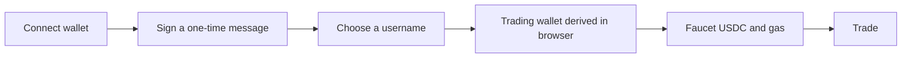
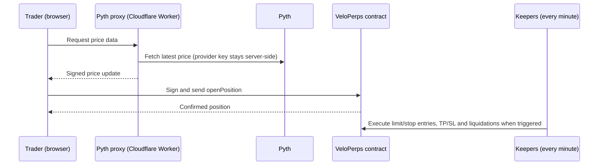
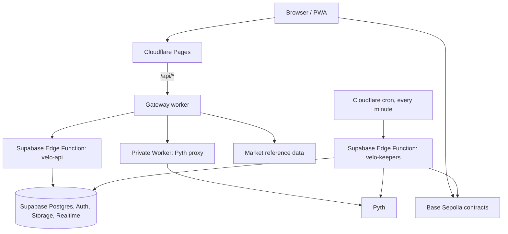

<h1 align="center">Velo</h1>

<p align="center">
  <b>The trader hub for crypto and, next, the rest of finance.</b><br/>
  Trade perpetuals, follow the people behind the trades, read the news and talk about it, all in one place.
</p>

<p align="center">
  <a href="https://app.velotrading.live">Open the app</a> ·
  <a href="https://velotrading.live">Website</a> ·
  <a href="https://velotrading.live/docs">Product docs</a>
</p>

<p align="center">
  <i>Live on Base Sepolia testnet. Mock USDC only. Not audited, not for real funds.</i>
</p>

---

## What Velo is

Most people who get into crypto end up juggling five tabs: an exchange to trade, a chart site, a news feed, a social app to see what traders are saying, and a spreadsheet to remember how they did. Velo puts those in one product.

It is a trading terminal with a social network built into it. You can open a position, share it, watch someone else's, argue about it in the replies, and check the market news without leaving the page. The goal is to be the place anyone with an interest in crypto and finance opens first, whether they have traded for ten years or ten minutes.

## Who it is for

**New traders.** The interface is built to be learned. Plain labels, a guided first run (connect, pick a username, get test funds and gas), clear liquidation and margin readouts on every position, and a community feed where questions get answered in context.

**Active and professional traders.** Market, limit and stop entries, take-profit and stop-loss, up to 25x leverage, live charts with indicators, a fills tape, position management and shareable trade cards. Orders are signed locally and settle on-chain.

**People who follow more than they trade.** Profiles, a following feed, a leaderboard, top-50 market pages with ticker discussions, and a news tab. Browsing needs no wallet.

## The vision

Velo is built around one idea: **trading is better when it is social, and social is better when the numbers are real.**

| Stage | What it adds |
| --- | --- |
| **Today** | Perpetual futures terminal, social feed, profiles, leaderboard, market directory, news, wallet onboarding, testnet bridge |
| **Next** | Copy trading with allocation, slippage and risk limits. Trading bots with scoped permissions, quotas and kill switches. On-chain reconstruction of every trader's history, so profiles and the leaderboard rest on verifiable results |
| **Later** | Classic instruments alongside crypto: stocks and commodities. Alerts, richer discovery, and a mainnet launch after independent security review |

Copy trading, bots and traditional instruments are **planned and not yet available**. Nothing in the app pretends otherwise.

## What you can do today

### Trade
- Perpetual markets priced by [Pyth](https://pyth.network): **BTC, ETH, SOL, DOGE, PYTH, BNB, XRP, HYPE, STETH**
- Isolated margin, market-specific leverage up to **25x**, minimum 1 mUSDC net collateral. Fees are 0.10% of notional per side, plus time-based borrowing fees (see [Economics](#economics))
- **Market, limit and stop** entries. Limits execute at the current adjusted oracle price, no worse than their limit; stop entries have a price bound and orders expire
- **Take-profit and stop-loss** on any position
- Keeper-triggered **liquidation** when remaining equity after settlement costs reaches the market's maintenance requirement
- Charts built on Lightweight Charts with Velo's own data feed, chart tools and indicators
- Live fills tape, open orders, position history and receipt-backed trade records
- Shareable trade cards

### Discover
- **Markets directory** covering the top 50 crypto assets by market cap, with prices, asset info, 24h / 7d / 30d history and a discussion thread per ticker
- **News tab** with the latest crypto headlines next to the conversation about them
- **Leaderboard** of top traders by profile performance

### Connect
- Posts, threaded replies, likes, reposts, follows, mentions and wall posts
- Public profiles with trade history and activity
- Notifications, link previews for shared posts, and verified badges for recognised accounts
- Installable as a PWA on desktop and mobile

### Move funds (testnet)
- Test-USDC faucet and gas sponsorship, so a new user can trade within a minute
- Wallet-to-wallet transfers with on-chain receipt verification
- Bridge routes across Base, Ethereum, Optimism and Arbitrum Sepolia using LayerZero OFT

## How it works

### Base Builder Code

Velo uses registered code `bc_s0k82w2v` for [ERC-8021 transaction attribution](https://docs.base.org/specifications/builder-codes/for-app-developers). Base and Base Sepolia writes pass the suffix before signing, including injected-wallet calls. Other chains are unchanged. The optional public build setting `VITE_BASE_BUILDER_CODE` overrides the registered default. Attribution does not guarantee funding or require a contract redeployment.

### First run



1. **Connect** any wallet through Reown. Signing a short, single-use message proves ownership and signs you in. No password.
2. **Choose a username.** It is stored on-chain in the Velo registry, one name per wallet.
3. **Trading wallet.** A second signature deterministically derives a dedicated trading wallet in your browser. The key stays on your device and the Velo database only stores its public address. This lets orders sign instantly, with no wallet popup on every click. Today the key sits in browser storage; permission-scoped session keys are on the roadmap.
4. **Fund** with the faucet, then trade.

### Placing and managing a trade



- **Market orders** settle after confirmation at the fresh oracle price with an adverse execution spread and a user price bound.
- **Limit, stop, take-profit and stop-loss** conditions are stored on-chain. A keeper checks them every minute and executes when the condition is met. A trigger is a condition, not a guaranteed fill price or deadline.
- Positions, fills and activity are recorded from confirmed transaction receipts.

### Social

Posts, replies, reactions and follows are written to Supabase under row-level security and update live over Realtime. Mentions and follows generate notifications. Shared links get server-rendered previews, so a Velo post looks right when pasted into X, Discord or Telegram.

## Architecture



### Frontend

React 19, TypeScript, Vite, wagmi v2 and viem, Reown AppKit for wallets, TanStack Query and Zustand for state.

- `src/App.tsx` is the application shell: Dashboard, Trade, Markets, Social, Leaderboard and Profile views.
- `src/components/` holds the UI: trading panels, order book and fills tape, charts, modals, social components and shared primitives.
- `src/services/` holds everything that touches the outside world: contract calls, Pyth streaming, wallet and session handling, Supabase access, and transfer and trade-receipt verification.
- **No optimistic state for money.** Balances and positions come from contract reads and confirmed receipts, not from what the UI expects to have happened.
- Design system in `src/styles/`: OKLCH colour tokens, glass surfaces, light and dark modes, Fraunces for display type and Geist for the interface.

### Backend

Velo runs on Cloudflare and Supabase.

| Layer | What it does |
| --- | --- |
| **Cloudflare Pages** | Serves the terminal and the landing site. `cloudflare/worker.js` is the `/api/*` gateway: it allow-lists routes and methods and forwards requests to the backend with a gateway credential |
| **Pyth proxy Worker** | Private Worker with no public endpoint. Checks the user's session, holds the Pyth provider key, rate-limits, and serves price REST, streaming and candle history |
| **Supabase `velo-api`** | Edge Function for wallet sign-in, gas sponsorship, incoming-transfer verification, link previews and protocol stats. Source lives in `api/` and is compiled into the function by `npm run build:supabase` |
| **Supabase `velo-keepers`** | Edge Function that scans and executes conditional orders, take-profit / stop-loss and liquidations. Signed transactions are persisted before broadcast and recovered after timeouts, and a durable lock prevents nonce collisions |
| **Keeper scheduler** | A Cloudflare Worker on a one-minute cron that calls the three keeper jobs in sequence, with retry and idempotent run IDs |
| **Supabase Postgres** | Profiles, posts, comments, reactions, follows, notifications, activity and fills, behind row-level security. Base schema in `supabase/schema/`, versioned changes in `supabase/migrations/` |
| **Market data** | `/api/market-data` serves the top-50 directory and coin history using a server-side provider key, with caching and bounded requests |

### Smart contracts

Built and tested with Foundry.

| Contract | Role |
| --- | --- |
| `VeloPerpsV4` | Active isolated engine with segregated escrow, reserved liquidity, bounded execution and market-specific risk |
| `VeloPerpsV3_1` | Legacy engine; existing positions, orders and free cross balances retain exit controls |
| `VeloRegistry` | Username to wallet mapping |
| `VeloMockUSDC` | 6-decimal test collateral with a faucet, bridgeable with LayerZero OFT |

V4 rejects Pyth updates older than five seconds and reserves each position's maximum gross profit at entry. Addresses are in [`contracts/deployments/base_sepolia.json`](contracts/deployments/base_sepolia.json). Build instructions and the risk specification are in [`contracts/README.md`](contracts/README.md).

## Economics

How money moves in the current testnet protocol, taken from the contract code:

- **Trading fees.** Opening costs 0.10% of requested notional. Position notional is then fixed from net collateral and leverage. Closing costs 0.10% of that fixed notional. Borrowing defaults to 1 basis point per hour on notional, capped by remaining equity. Exact settlements are authoritative.
- **The liquidity pool.** Protocol-owned liquidity is separate from position collateral, pending-order escrow and accrued fees. Each position reserves its entire notional as maximum gross profit. **Gross profit is capped at one notional; loss is capped at collateral.** There are no public LP shares or deposits. This is a bounded testnet model, not an uncapped perpetual exchange.
- **Liquidations.** Maintenance defaults to 0.50% of notional, with market-specific settings. Borrowing costs and closing fees affect equity. Keeper execution pays up to 0.05% of notional from remaining equity. The one-minute keeper schedule is not a guaranteed execution deadline.
- **What the owner can and cannot do.** The owner can fund liquidity, withdraw unreserved liquidity and fees, pause new entries, and configure risk when a market has no positions or orders. A guardian can pause entries but cannot resume or withdraw. Neither can withdraw trader escrow or reserved profit. Pausing entries does not disable closing or cancellation.
- **Revenue share and copy trading.** Revenue sharing with traders who are copied, and fees on copy trading and bots, are planned and not implemented. See [VISION.md](VISION.md) for the model under consideration.

## Repository layout

```
src/                 React app (components, services, styles)
api/                 Handlers compiled into the Supabase velo-api function
cloudflare/          Pages gateway, Pyth proxy Worker, keeper scheduler Worker
supabase/            Edge Functions, migrations and base schema
contracts/           Solidity contracts, scripts and Foundry tests
shared/              Market allow-list shared by the app and the price proxy
scripts/             Build, packaging and acceptance scripts
tests/               Node test suite
public/              PWA manifest, icons, service worker, social images
```

## Run it locally

Requires Node 20 or newer.

```sh
npm ci
npm run dev          # Vite dev server
npm run typecheck    # TypeScript
npm test             # Node test suite
npm run build        # Production build
```

The app needs public configuration (`VITE_*` variables for RPC endpoints, contract addresses and a WalletConnect project ID); `scripts/check-cloudflare-env.mjs` lists them. Never put a private key, a Supabase service-role key or an oracle provider key in a `VITE_*` variable, because those are embedded in browser code. Local Vite does not emulate the Cloudflare gateway, the Pyth proxy or the live backend secrets.

## Deployment

- **Frontend and gateway.** Cloudflare Pages builds the production branch with `npm run build:cloudflare` (typecheck, env check, Vite build, gateway packaging) and publishes `dist`.
- **Backend.** Supabase functions are deployed separately with the Supabase CLI after `npm run build:supabase`. Workers are deployed with Wrangler using the configs in `cloudflare/`. A frontend push does not deploy either.
- **Secrets** live in Cloudflare and Supabase secret stores, never in the repository.
- **Keepers.** Run exactly one scheduler against the keeper wallet. Two schedulers on one wallet cause nonce conflicts.

## Status

Velo is an early-stage product running on **Base Sepolia testnet with mock USDC**. V4 is deployed at `0xE9AEcFbc5814ce3b2dB0107594d80F054e6dB52f`. The contracts have **not been independently audited**; independent security review is a prerequisite for any mainnet launch.

Nine perpetual markets are enabled in V4. Cross margin, partial closes and margin adjustment are absent from its contract. Legacy positions are not automatically migrated. The leaderboard still ranks stored profile metrics rather than independently reconstructed on-chain results.

## Roadmap, vision and business model

The long-term plan, the revenue model under consideration and the ideas we want to explore are in [VISION.md](VISION.md). It is written for investors and contributors.

## Security

Please report vulnerabilities privately to the maintainers rather than through public issues.
