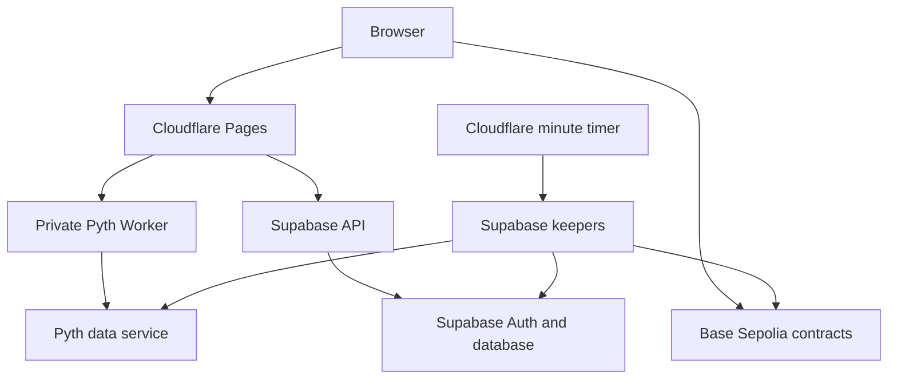

# VELO — social trading testnet

[Terminal](https://app.velotrading.live) · [Website](https://velotrading.live) · [Product docs](https://velotrading.live/docs)

VELO combines a crypto perpetuals terminal with profiles, posts, replies and follows on **Base Sepolia (84532)**. Trading uses mock USDC and a custom Pyth-priced contract. This is a restricted, experimental testnet, **not an independently audited exchange or a real-money product**.

**Status: 16 October 2026.** Cloudflare serves both sites. Supabase runs the database, authentication and backend. A Cloudflare timer calls the trading keepers every minute. Vercel is paused. The migration retained the existing database and contracts.

The engineering review found serious contract accounting and legacy account-authorization defects. New signature login, private contact APIs, owner-only notification reads and receipt-verified incoming transfers are deployed, but the legacy-account/social cutover is still pending. The frontend blocks new cross-margin activity, margin adjustments and reduce-only entry orders on the current contract. These client checks do not prevent direct contract calls. **Do not use real funds.**

## Start here

| Document | Purpose |
| --- | --- |
| [CLOUDFLARE.md](CLOUDFLARE.md) | Publish updates, manage secrets, monitor jobs and recover deployments |
| [FEATURES.md](FEATURES.md) | Implemented, restricted, unverified and planned features |
| [docs/AUDIT-2026-10-15.md](docs/AUDIT-2026-10-15.md) | Findings, evidence, test coverage and release gates |
| [contracts/README.md](contracts/README.md) | Contract addresses, accounting defects and reproduction tests |
| [audit-plans/README.md](audit-plans/README.md) | Unapplied account/social cutover and its approval requirements |
| [migration/STATUS.md](migration/STATUS.md) | Historical hosting migration and transaction evidence |

## What happens when someone uses VELO

1. Reown connects an owner wallet. A short-lived, single-use message signature authenticates it to Supabase through `velo-api`.
2. A separate signature derives a trading wallet. This is a full EOA whose private key is stored **in plaintext in browser localStorage**, not a permission-limited session key. Back up the key; identical recovery across wallet implementations is not guaranteed.
3. The trading wallet receives testnet gas and mock USDC. On-chain trading requires Base Sepolia, a funded signer, current Pyth data and contract confirmation.
4. Market transactions settle against a contract pool. Conditional entry, TP/SL and liquidation execution depend on the keeper, the oracle and available gas. A trigger is not a guaranteed fill price or an execution deadline.
5. Profiles and social activity live in Supabase. The current leaderboard and shared performance data are not an authoritative chain indexer and must not be represented as unforgeable returns.

Copy trading and algorithmic trading are planned. The former simulated copy action now displays a planned-feature message instead of creating database positions.

Receipt-backed close classification, explicit failed-refresh states and bounded chart/fill loading are included in the 16 October follow-up. The confirmed manual-close record previously labelled liquidation was corrected. Chart history starts with a smaller cached page and loads older candles on demand; exchange display fallback cannot replace Pyth settlement data. See the audit addendum for evidence and remaining indexing limits.

## Infrastructure



| Component | Deployment |
| --- | --- |
| Terminal and API gateway | Cloudflare Pages `velo-trading-terminal` → `app.velotrading.live` |
| Landing and product docs | Cloudflare Pages `velo-landing` → `velotrading.live` |
| Authenticated REST, SSE and candle access | Private Worker `velo-pyth-proxy` |
| Login, sponsorship and transfer verification | Supabase `velo-api` |
| Conditional orders, TP/SL and liquidations | Supabase `velo-keepers` |
| Scheduler | Worker `velo-keeper-scheduler`, `* * * * *` |
| Identity, social data, storage and realtime | Existing Supabase project `btgfoekgvyvdflzjfehz` |
| Domain | Namecheap registration; Cloudflare DNS and HTTPS |

Free hosting has quotas. Domain renewal, oracle access, independent security work and future mainnet operations have separate costs.

## Development and deployment

```sh
npm ci
npm run typecheck
npm test
npm run build
npm run dev
```

Supply the required public configuration in your local environment; see `scripts/check-cloudflare-env.mjs` and the hosting guide. Never put a wallet key, Supabase service-role credential or Pyth provider key in a `VITE_*` variable: those values are embedded into browser code. Local Vite alone does not emulate the protected Pages gateway, private Worker or live backend secrets.

Both sites automatically deploy commits to **`codex/cloudflare-migration`**, not `main`. The terminal build is `npm run build:cloudflare`, output `dist`. That command includes TypeScript checking. A frontend push does not apply SQL or deploy standalone Workers/Supabase functions. The destructive pending cutover is deliberately outside `supabase/migrations`; do not run it as routine setup.

## Validation and limitations

The review ran TypeScript checking, a production build, 91 Node tests and seven Foundry tests. **Three Foundry tests pass by reproducing bugs**, not by proving a safe contract. Focused live tests checked signature login, replay rejection, upgraded-account password rejection, private contact access and notification ownership. Temporary test accounts were removed.

At 00:54 UTC on 16 October, keeper logs showed 60 runs for each of three jobs over the inspected hour with zero reported errors. Historical testnet receipts cover sponsorship, a limit entry/TP and liquidation. This does not establish every long/short, stop/SL, partial-close or outage scenario.

Authenticated mobile/browser journeys, every bridge route and complete social interactions remain unverified. The production browser was blocked in the review environment. Read the audit before expanding access or treating test results as a security certification.
