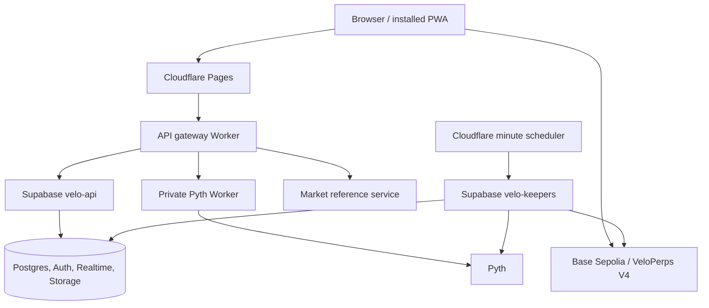

# Velo architecture

Velo combines a React trading workspace, account and social services, private price infrastructure and a Solidity execution engine. This reference describes the current Base Sepolia deployment.

## System map

## Frontend

React 19, TypeScript and Vite provide the application shell. TanStack Query coordinates remote data and Zustand holds interface state. Reown AppKit connects wallets; wagmi and viem handle chain interaction. Shared Switzer/Fraunces typography and material tokens support responsive light and dark interfaces.

`src/App.tsx` coordinates Dashboard, Trade, Markets, Social, Leaderboard and Profile. Shared components provide dialogs, charts, animated values, search, social writing and trade sharing. Services own API calls, prices, sessions, wallet setup, contract reads and receipt verification.

## Identity and wallet flow

1. A connected wallet signs an expiring login challenge.
2. The API verifies ownership and establishes the account session.
3. A separate fixed-message signature derives the trading wallet used for local order signing.
4. The account stores its public trading address; wallet controls provide backup/export actions on the device.

Valid sessions restore across page reloads. Explicit logout and session expiry return to wallet selection/sign-in. The Velo registry links readable handles to addresses. [Security](SECURITY.md) documents key handling and authorization details.

## Price services

The private Pyth Worker holds provider credentials and serves authenticated price requests and streaming/history routes through the gateway. The contract validates signed execution updates, including freshness and confidence. Chart/reference candles and the update accepted at execution serve different parts of the workflow.

CoinMarketCap supplies the wider top-50 directory and asset information through a cached server-side service.

## Trading engine

**VeloPerps V4** is deployed at `0xE9AEcFbc5814ce3b2dB0107594d80F054e6dB52f` on Base Sepolia (84532).

Markets are **BTC, ETH, SOL, DOGE, PYTH, BNB, XRP, HYPE and STETH**. The shared market registry supplies pair identifiers, feeds and leverage limits; active contract settings determine runtime permissions.

V4 uses isolated collateral and fixed position notional. Its ledgers separate position collateral, pending-order margin, protocol pool assets and fees. Profit capacity is reserved at entry. Market entries validate signed prices and risk limits atomically, including optional TP/SL. Conditional entries reserve margin until execution or cancellation.

Active positions, orders and protection read from contract state. Confirmed receipts connect successful writes to history and activity. Submitted transactions retain their hash through reconciliation. [Execution and accounting](EXECUTION.md) covers formulas, bounds, deadlines and settlement.

## Keepers

The Cloudflare scheduler invokes conditional-entry, protection and liquidation jobs on a one-minute schedule. `velo-keepers` obtains price updates, evaluates candidates and submits transactions. Durable signer coordination and persisted transaction state support nonce management and recovery after delayed responses.

## Account equity and performance

Dashboard equity combines available wallet balance, refundable pending-order collateral and estimated position payouts. Private observations are scoped to account, trader, chain and engine in Supabase, with a bounded device cache. Verified historical account checkpoints extend the record where archive state and prices are available.

Performance uses realized settlement records for cumulative PnL, period results, market breakdowns and the settlement calendar. Cash movements and open-position PnL remain separate from realized trading results. Range availability and date labels follow the coverage and the viewer's locale/time zone.

## Social and sharing

Postgres stores profiles, posts, comments, reactions, follows and notification events under API authorization and row-level policies. Realtime distributes social changes. Storage holds owner-scoped avatar/banner uploads and immutable PnL snapshots.

`SocialTextField` supplies @people and $asset completion across composers. Coin pages publish through the shared feed flow with an automatic cashtag. Public routes use `/p/<post>`, `/p/<post>/r/<reply>` and `/profile/<handle>`; link handlers provide external previews.

Position attachments read linked chain state and current marks. Live PnL cards update persistent HTML values in place, then display a static result after settlement. PNG exports use a 2400 × 1600 renderer. The media viewer shares the post's actions and comment thread. See [Sharing](SHARING.md) for the component map.

## Transfers and activity

Funding and send flows reconcile transaction receipts before recording success. Incoming-transfer verification checks mUSDC events and deduplicates activity. Settlement transfers are classified with their trade outcome; released margin remains part of settlement.

LayerZero OFT supports testnet routes across Base, Ethereum, Optimism and Arbitrum Sepolia. Source confirmation and destination delivery are tracked separately.

## Operator controls

The Admin view connects authorized pool, fee, market and risk actions to contract permissions. Operator withdrawals preserve escrow and reserved profit. A guardian can pause entries; closing and cancellation remain available through the engine's pause rules.

## Repository and release references

[Operations](OPERATIONS.md) covers environment settings, builds, deployments, migrations and recovery. [Contracts](../contracts/README.md) covers Solidity and Foundry. [Security](SECURITY.md) records review and key-handling considerations. [FUTURES](../FUTURES.md) describes the next engine workstreams.
