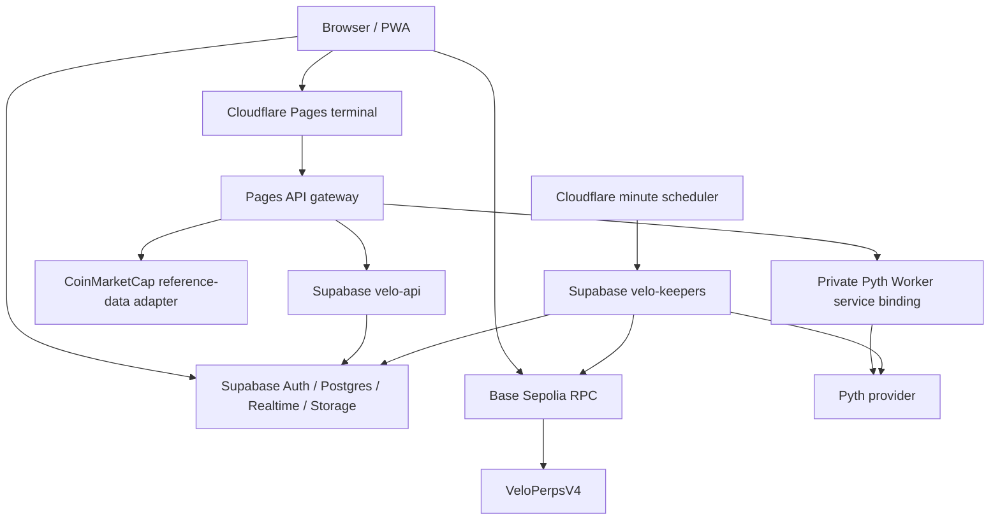

# Velo architecture

Reviewed 27 October 2026. Read [VISION](../VISION.md) for the product thesis and [Operations](OPERATIONS.md) for release procedures. This describes the deployed testnet design, not a claim of mainnet readiness.

## Product and interface

Velo combines trading, market discovery, news and a social network. The React 19/TypeScript/Vite frontend uses wagmi/viem, Reown AppKit, TanStack Query and Zustand. Shared design tokens live in `src/styles/`; Switzer covers the interface and animated figures, Fraunces retains the wordmark/editorial voice, and Geist Mono covers technical labels. Light/dark glass surfaces, native dialogs, reduced-motion support and responsive order panels share that system.

| Route | Responsibility |
| --- | --- |
| `/dashboard` | Wallet/equity overview, active positions, confirmed activity and funding controls |
| `/trade/<BASE>-USD` | V4 entry ticket, positions, protection, conditional orders, chart and informational fills |
| `/markets` and `/markets/<asset>` | Top-50 reference directory and coin details/discussion; not a social-category route |
| `/social`, `/profile/<handle>` | Feed, profiles, reactions, replies, reposts, follows and mentions |
| `/p/<post>` and `/p/<post>/r/<reply>` | Short canonical post/reply URLs with crawler previews |
| `/leaderboard` | Experimental ranking of stored profile metrics, not independently indexed results |
| `/admin` | Owner-authorized V4 liquidity/risk/entry controls; UI visibility is not contract authorization |

Check `src/App.tsx` and `shared/socialLinks.mjs` when changing navigation. Coin-page back navigation and related-coin navigation are separate callbacks; a click event must never become an asset ID.

## Hosting boundaries

- `velo-trading-terminal` serves the app. `cloudflare/worker.js` packages into `dist/_worker.js`, allow-lists API methods/routes and forwards authenticated backend requests with a server credential. It does not publicly expose keeper routes.
- `velo-pyth-proxy` has no workers.dev endpoint. Its service binding validates sessions, applies rate limits, and serves oracle updates, streams and history without exposing the provider key.
- `/api/market-data` is a separate cached reference-data adapter. CoinMarketCap directory metadata/prices and history are not settlement inputs.
- `velo-api` handles wallet challenges, verification, gas sponsorship, transfer reconciliation, previews and stats. Some handlers retain `api/` paths because the Supabase build consumes them; the directory is not evidence of an active Vercel deployment.
- `velo-keepers` performs conditional entries, TP/SL and liquidations. One Cloudflare scheduler calls these scopes every minute. Durable run IDs, signer coordination and signed-transaction recovery reduce duplicate execution; no deadline or continuous execution SLA is guaranteed.
- `velo-landing` is a separate Pages project for the website, public docs and blog. Git pushes do not deploy Supabase functions or the standalone Workers.

## V4 execution

Active engine: `0xE9AEcFbc5814ce3b2dB0107594d80F054e6dB52f`, chain 84532. The [manifest](../contracts/deployments/base_sepolia.json) records the deployment transaction and dependencies. V4 is source-verified, not audited.

Nine perpetual markets: **BTC, ETH, SOL, DOGE, PYTH, BNB, XRP, HYPE, STETH**. Maximum leverage is 25x for BTC/ETH, 20x SOL/BNB, 15x XRP and 10x the remaining markets. USDT, USDC, WBTC and JITOSOL are excluded from perpetual entry even if the provider permits their reference feeds. Market indices are stable identities and must not be renumbered.

V4 has fixed isolated collateral and full closes. It does not expose cross margin, partial close or add/reduce margin. Market/limit/stop entry can carry TP/SL atomically. Position protection is not another collateral-backed entry order: the app projects it from confirmed positions into Open Orders, and cancelling a leg updates the position's on-chain triggers.

The pool reserves one fixed position notional per entry as maximum gross profit. Collateral escrow, order escrow and fees are separate from pool assets. Fees are based on notional, not gross payout. Settlement includes adverse spread, borrowing, closing costs and any keeper bounty. Read the [contract reference](../contracts/README.md) for equations, bounds and privileges.

Only fresh signed Pyth updates authorize execution. Chart/display history and CoinMarketCap snapshots cannot authorize orders. Price bounds, deadlines, risk caps, oracle age/confidence checks and receipt confirmation all remain in the execution path; they must not be removed to reduce perceived latency.

## State and recovery

- V4 contract reads are authoritative for active positions and orders. Session hydration and database Realtime subscriptions must not reinsert V3/demo records into that view.
- V3.1 is immutable and remains deployed at `0x41fDb544D7247a5ddc6B4C06F29D09f2b20de907`. Legacy exits/cancellation/free cross withdrawals use explicit legacy routing. There is no automatic position migration, collateral transfer or database reset.
- The shared Base Sepolia transport can fail over read requests. An ambiguous broadcast may retry only identical signed bytes; its original hash is journaled. A timeout is not proof of rejection or success. Check the receipt and nonce state before another submission.
- Transfers and activity are reconciled against token/engine events. A settlement returning margin is not a new external deposit; duplicate raw-transfer and semantic events are suppressed/reconciled. A chain indexer is still required for complete historical reconstruction.

## Authentication and data

Wallet connection and application sign-in are distinct. An expiring, single-use challenge is signed by the selected connected account; the backend verifies it before establishing Supabase authentication. Cancellation/account changes invalidate the attempt. Sign-in stages have bounded waits and a switch-wallet route. Session controls use 30 minutes of inactivity and an eight-hour maximum; logout leaves chain positions and keepers running.

A separate signature derives the dedicated browser trading wallet. Its full key is stored locally without encryption at rest, not as a constrained smart-account session permission. Only its public address belongs in profiles. This remains a major mainnet security gate; browser storage must not be treated as a secure vault.

Supabase stores profiles, posts/comments/reactions, follows, notifications, preferences and receipt-backed activity/fills. Public social reads and private session/notification/contact data have different access rules. Follow counters are database-maintained; event-validation functions check social notification context. Remaining historical contact fields, overlapping old policies, legacy credentials and lifecycle/moderation coverage require further work. See [Operations](OPERATIONS.md) rather than assuming all security work is complete.

## Sharing and interface boundaries

[The sharing guide](SHARING.md) is the product/implementation reference. `PositionComposerTools` selects an open position and preserves the written draft; `VeloShareCard` presents compact attachments or PnL images. `tradeShare.ts` validates public metadata before rendering. `useSharedTrade` reconciles visible live shares with the fixed V4 engine, while `shareBehavior.mjs` distinguishes snapshot, live settlement and captured-PnL freeze behavior. Available marks update open PnL estimates between approximately ten-second chain reads; visibility and connectivity affect freshness.

`PositionDetailsDialog` reads current position context and opening/settlement evidence, checking engine, owner and position ID. Receipt absence and refresh failure remain labelled states. This per-trade evidence does not authenticate a user's entire performance history. Amount hiding applies to the attachment and details presentation; it does not restrict public chain access. Snapshot image posts use immutable Storage assets; live image posts render from current share metadata. Externally exported PNGs never update remotely.

Shared surface tokens, `materials.css` and `Dialog` own the app's light/dark glass palette and modal material. `GlassNav` repositions one selected-destination lens on navigation/resize without remounting controls. Composer fields have a scoped transparent focus treatment; attachments occupy their own row above the actions. Motion has reduced-motion support and opaque material fallbacks. These UI choices do not change signing, oracle requirements or settlement.

## Still planned

Permission-scoped trading keys, a durable chain indexer, independently verified rankings, copy trading, strategy bots and traditional instruments are not implied by the current architecture. Public LP shares, insurance and funding-rate systems need separate reviewed designs. The product direction remains a broad trader hub; V4 is the current execution foundation, not the limit of that vision.

### Social notification lifecycle

`notifications.actor_id` is set by the validated social-event RPC, not accepted from client copy. Private delete triggers on likes, comment_likes, reposts and follows mark the matching recipient alert with `retracted_at`. Event creation and undo share a transaction advisory lock; active deduplication is scoped to the actor/event/reference. Recipient Realtime UPDATEs remove the item. Read queries exclude retractions, and in-memory tombstones prevent stale fetches from resurrecting them. Post/comment foreign-key deletion behavior remains, with an immediate debounced notification resync. See `tests/notification-events.sql` and `tests/notification-undo.sql` for rollback-only DB checks.

### Coin workspace

`src/components/TokenPage.tsx` owns the asset workspace outside the app shell: market history, four reference statistics, official resource links, news and the cashtag-filtered conversation. `CoinComposer` uses the shared `SocialTextField` and the application’s `handleCreatePost`; it does not introduce another API, post table or notification path. Successful creation updates the common `posts` state. Existing `PostCard` handles replies and reactions. The chart supports pointer/touch and keyboard timestamp inspection, locale labels and shared-layout metric/timeframe controls. Directory membership still does not authorize perpetual trading.

## Dashboard presentation

`Dashboard` consumes existing account totals and positions; the compact portfolio chart does not stretch to the height of the sidebar. `PositionExposure` keeps only margin/PnL and a composition strip inline. Its full actual-notional breakdown opens in `TradingDialog`, so additional positions never increase the dashboard rail height. Selecting a row closes the breakdown before handing off to the existing position-inspection dialog. It introduces no RPC or execution path. `DashboardAccount` keeps wallet/engine explorer and copy controls behind an accessible animated disclosure. The shared app shell aligns navigation while Social, Markets, asset and profile pages keep their existing content limits.

## Wallet dialog presentation

`VeloDepositModal` owns the selected deposit/withdraw direction and network; App mounts one instance and uses the callback direction to record activity/notifications. `VeloSendModal` retains the existing transfer outbox, receipt verification and recovery path. `VeloFaucetModal` retains its existing setup/claim lock. These views and `SettingsModal` share `TradingDialog`, `WalletPresentation`, measured content transitions, native segmented controls and persistent action footers. Pending work disables navigation/dismissal. Base wallet balance/receipt reads are pinned to chain 84532, independently of the wallet's selected network. No database schema or contract configuration changes accompany this presentation release.

Settings keeps contact drafts across section changes and uses the existing authenticated contact-email RPC. Security content is only rendered in its own section; navigating away hides any revealed key. Existing recovery/signing services and explicit export confirmation remain in place.
