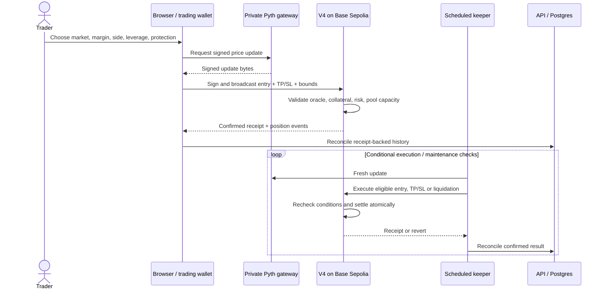

# V4 execution and accounting

Reviewed 31 October 2026 against [VeloPerpsV4.sol](../contracts/src/VeloPerpsV4.sol). Active deployment: [0xE9AEcFbc5814ce3b2dB0107594d80F054e6dB52f](https://sepolia.basescan.org/address/0xE9AEcFbc5814ce3b2dB0107594d80F054e6dB52f#code), Base Sepolia 84532. All collateral is test mUSDC. Runtime market settings remain authoritative.

## The trading model

Velo executes oracle-priced positions against protocol-owned liquidity. It does not match opposing user orders, run a central limit order book or discover prices from its fills tape. Limit and stop entries are on-chain conditional requests against the same pool.

## Opening a market position

1. The app reads active V4 account state, token balance/allowance and enabled market settings. It builds the requested position and optional TP/SL.
2. A backend price gateway supplies the signed Pyth update. The key is server-side; the contract validates the signed update, not the frontend's displayed price.
3. The browser trading wallet signs and submits the transaction with update fees, a deadline and price limit. Market-entry deadlines cannot be more than five minutes ahead.
4. V4 rejects paused/disabled entries, stale or invalid prices, leverage/position/open-interest/block-volume limits, invalid protection or insufficient available pool liquidity. Default accepted oracle age is five seconds. Per-market confidence and spread settings also apply.
5. The opening fee is separated, net collateral is escrowed, fixed notional is recorded, maximum gross profit is reserved and both protection levels are stored atomically.
6. The app reports a confirmed open after a successful receipt, then reconciles records. A transaction hash alone is not a fill.

## Conditional entries

`placeConditionalOrder` locks the requested gross collateral in order escrow. It does not open a position, consume a spot order book or reserve a guaranteed execution price. The app currently requests a seven-day expiry; the contract permits a deadline at most 30 days ahead.

A limit buy needs an eligible price at/below its limit; a limit sell needs at/above. A stop buy needs at/above its trigger; a stop sell needs at/below. Execution uses the then-current adjusted oracle price and checks the submitted adverse-price bound. Available liquidity and risk limits are rechecked at execution. The escrow remains pending if execution cannot succeed; cancellation/eligible expiry recovery returns collateral according to the contract path.

Keepers are scheduled every minute. Scheduling is not a one-minute fill guarantee: prices, liquidity, RPC availability, pending nonces and transaction inclusion can delay execution. Orders are not sorted into price-time matching priority.

## Protection and settlement

TP/SL are fields on a V4 position. Open Orders projects those fields as linked protection, not unrelated duplicate entry orders. Saving protection is an on-chain edit; cancelling TP does not cancel SL. Triggered protection and liquidation use fresh signed prices, the applicable execution spread and the minimum hold rules where relevant. A threshold being touched on a reference chart is not proof of an executable on-chain trigger.

V4 closes positions in full. A manual close has a deadline and adverse-price bound. Liquidation checks settlement equity, including costs, against maintenance on fixed notional. An entry pause does not prevent existing-position close or order cancellation.

The confirmed close event is the settlement record. Returned collateral is not a deposit. Missing RPC data or a missing position in a response must not be classified as liquidation without matching evidence.

## Fees and a worked example

USDC amounts use six decimals, prices use 18-decimal fixed point, and one basis point is 1/10,000. Integer rounding in the contract is authoritative.

For gross margin `M` and integer leverage `L`:

- Opening fee: `M × L × 0.10%`.
- Net collateral: `M − opening fee`.
- Fixed notional: `net collateral × L`.
- Gross PnL: `notional × signed price change / entry price`, capped at one notional in profit and at net collateral in loss.
- Borrow fee: `notional × market hourly borrow rate × elapsed time / hour`, capped by remaining equity. Default rate: 0.01% per hour.
- Closing fee: 0.10% of fixed notional, capped by remaining equity.
- Keeper bounty, when applicable: up to 0.05% of fixed notional, also limited by remaining equity.
- Payout: net collateral plus capped gross PnL, less borrow, close fee and any bounty.
- Realized net PnL: payout minus **original gross margin**; it therefore includes the opening fee once.

Example: 100 mUSDC gross margin at 10× produces a 1 mUSDC opening fee, 99 collateral and 990 notional. A long opened at 100 and manually closed at 102 exactly one hour later has 19.80 gross profit, 0.099 borrowing and 0.99 closing fee. Payout is 117.711 mUSDC, so realized net PnL is **17.711**, or **17.711% on the original 100 margin**. This illustration assumes those exact execution prices, no keeper bounty and no additional gas/oracle cost; spreads can change actual entry/exit prices.

## Pool conservation

| Ledger | Meaning | Withdrawal rule |
| --- | --- | --- |
| `poolAssets` | Protocol capital plus realized trader losses, less paid trader profits | Owner may withdraw only the unreserved part |
| `reservedProfit` | Sum of active positions' fixed notional; a reservation within pool assets | Released on settlement; not a second token balance |
| `collateralEscrow` | Net collateral supporting open positions | Settles only through position rules |
| `orderEscrow` | Gross collateral locked in pending entries | Consumed at entry or refunded on cancellation/recovery |
| `feeBalance` | Accrued protocol fees | Separate authorized withdrawal |

`accountedBalance = poolAssets + collateralEscrow + orderEscrow + feeBalance`.

`availableLiquidity = poolAssets − reservedProfit`.

An owner cannot withdraw trader escrow or already-reserved profit capacity. Each new position needs enough available liquidity for its entire notional profit cap. This conservative reservation materially limits capital efficiency. There are no public LP shares, funding payments between longs/shorts, insurance fund or order-book market makers in V4.

## State and evidence

| Question | Authority |
| --- | --- |
| Did an order/position change? | Successful transaction receipt, V4 storage and matching events |
| What price executed? | Contract-validated oracle data plus V4 spread/bounds logic |
| What is open PnL now? | An estimate from current marks and accrued costs; not realized settlement |
| What happened in a past trade? | Recorded confirmed settlement; independent event-indexer reconciliation is still needed |
| What was equity on a past date? | Saved observations or verified checkpoints, with their coverage limits |
| What does a social share prove? | Its linked position/receipt context, not a verified full trading history |

History records, leaderboard summaries and social content are stored in Supabase. They are not a replacement for contract state. Legacy receipts retain their original engine namespace so IDs from different deployments do not collide.

## Remaining operating risks

Source verification and automated tests are not an independent audit. Before real-fund launch, prioritize constrained signing, durable event indexing, keeper redundancy and latency monitoring, oracle failure behavior, capital stress tests, controlled admin keys and an independently reviewed migration/recovery plan. [FUTURES.md](../FUTURES.md) separates those requirements from optional new market designs.
